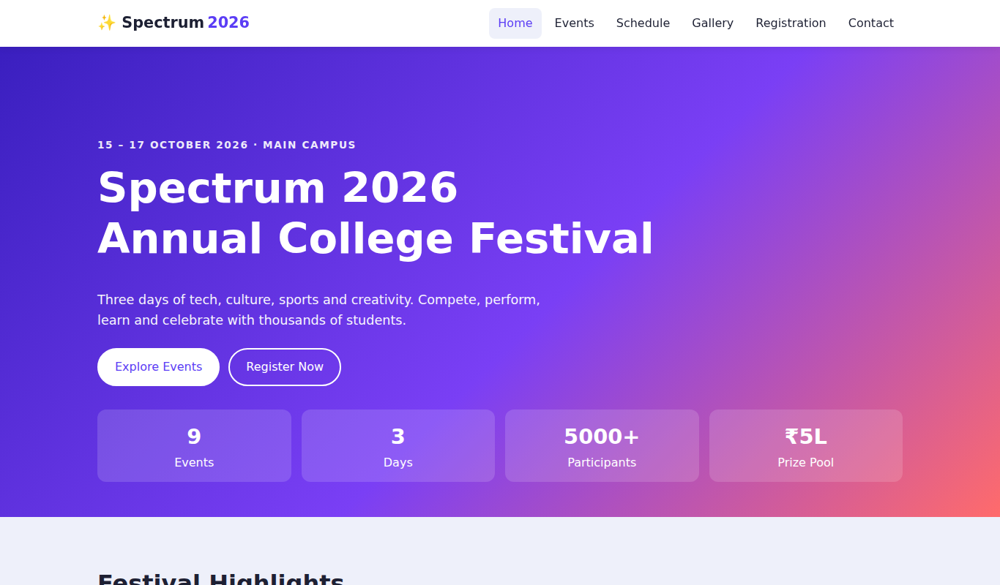
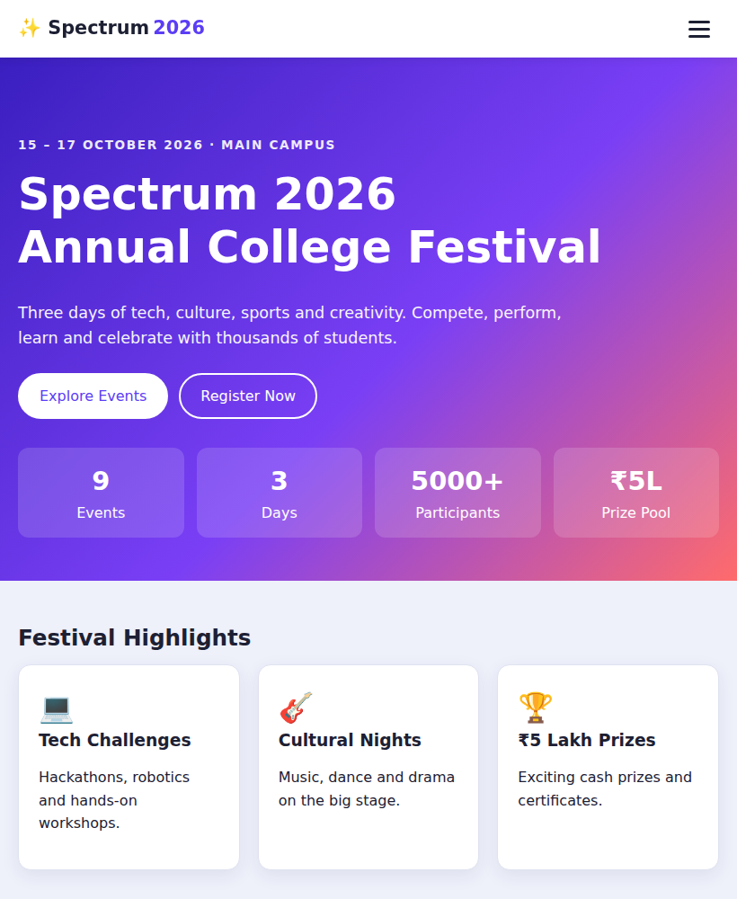
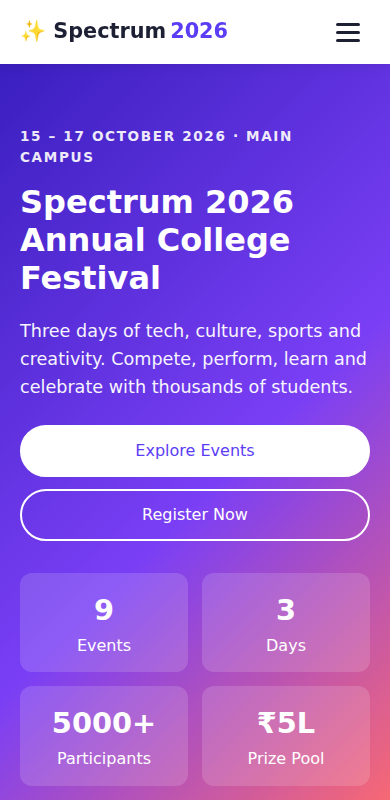
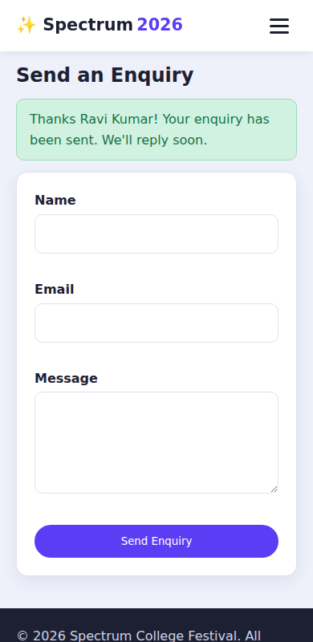

# Spectrum 2026 – College Event Portal

## Project Objective
A responsive, multi-section college festival website where students can browse events, filter them, view the schedule, register, and contact the organisers – built with only HTML5, CSS3 and Vanilla JavaScript (no frameworks or libraries).

## Features
- Sticky responsive header with mobile hamburger menu and active-link highlighting
- Home: festival banner, live stats, highlights, dynamic announcements, CTA buttons
- Dynamic event cards (name, date, time, venue, category, Register button)
- Category filters + live search; day-wise schedule tabs
- "Register" on a card auto-selects the event in the form and scrolls to it
- Registration form with JS validation, inline errors and success/failure banners
- Duplicate protection (same email + same event)
- Records saved in `localStorage`; delete single record or clear all
- Gallery with captions and keyboard-accessible lightbox (Esc, ← →)
- Contact details and validated enquiry form (saved to `localStorage`)
- Sticky-bottom footer, skip link, ARIA labels, live regions, reduced-motion support

## Technologies
HTML5 (semantic elements, `<dialog>`), CSS3 (Grid, Flexbox, custom properties, media queries), Vanilla JavaScript (ES6, `localStorage`, `IntersectionObserver`).

## Project Structure
```
college-event-portal/
├── index.html          # BUILT, self-contained page (CSS + JS inlined) - open this
├── template.html       # Source HTML that links css/ and js/
├── build.py            # Rebuilds index.html:  python3 build.py
├── css/style.css       # All styling + responsive rules
├── js/
│   ├── data.js         # Events, announcements, gallery, departments
│   ├── utils.js        # DOM, storage, formatting, validation helpers
│   └── app.js          # Feature modules: Nav, Home, Events, Schedule, Register, Gallery, Contact
├── screenshots/        # Add screenshots here
└── README.md
```

## Setup Instructions
1. Download the whole folder (or `college-event-portal.zip`) and extract it.
2. Open `index.html` in any modern browser. It has CSS and JS inlined, so it renders correctly even if opened on its own. (Chrome, Edge, Firefox, Safari). No build step or server needed.
3. Optional: serve locally with `python -m http.server` and visit `http://localhost:8000`.

To change content, edit `js/data.js` (or `css/style.css`), then run `python3 build.py` to regenerate `index.html`.

### Why the CSS once failed to load
The original `index.html` linked `css/style.css` and `js/*.js` by relative path. Those paths were correct, but if `index.html` is downloaded or opened without the `css/` and `js/` folders beside it, the browser cannot find them and shows raw HTML. The built `index.html` now embeds everything, so this cannot happen.

## Functionality Guide
| Area | How it works |
|------|--------------|
| Navigation | Links scroll to sections; hamburger toggles `aria-expanded`, closes on link click / Esc |
| Events | Rendered from `PortalData.events`; filter chips and search re-render the grid |
| Schedule | Day tabs show that day's events sorted by time |
| Registration | Validates name, email, 10-digit Indian mobile (6–9 start), department, year, event |
| Records | Stored under `spectrum_registrations`; Delete/Clear All update storage and table |
| Gallery | Click a tile to open the lightbox; navigate with buttons or arrow keys |
| Contact | Validates name, email, message (10+ chars); saved under `spectrum_enquiries` |

## Responsive Design
- Mobile-first fluid layout using `clamp()`, CSS Grid `auto-fit/auto-fill` and Flexbox
- Breakpoints at 820px (hamburger nav, single-column forms) and 520px (stacked fields/footer)
- Tables scroll inside their own container, so the page never scrolls horizontally
- `body` is a flex column with `main{flex:1}`, keeping the footer at the bottom without overlap

## Testing Performed
Real Chromium (Playwright) run at 1366px, 820px and 390px widths; verified computed styles, no horizontal scroll, and no console errors, then the full flow (navigation → filter → schedule → preselect event → validation errors → success → duplicate check → delete/clear → lightbox → contact) passed with **zero console errors**. Please also do a quick visual check in a real browser at desktop, tablet and mobile widths (DevTools device toolbar).

## Screenshots





## Learning Outcomes
- Structuring a multi-page-style site with semantic HTML
- Responsive layout with Grid, Flexbox and media queries
- DOM manipulation and safe rendering (`textContent`, no `innerHTML`)
- Form validation and user feedback patterns
- Persisting data with `localStorage`
- Modular JavaScript organisation and accessibility basics
